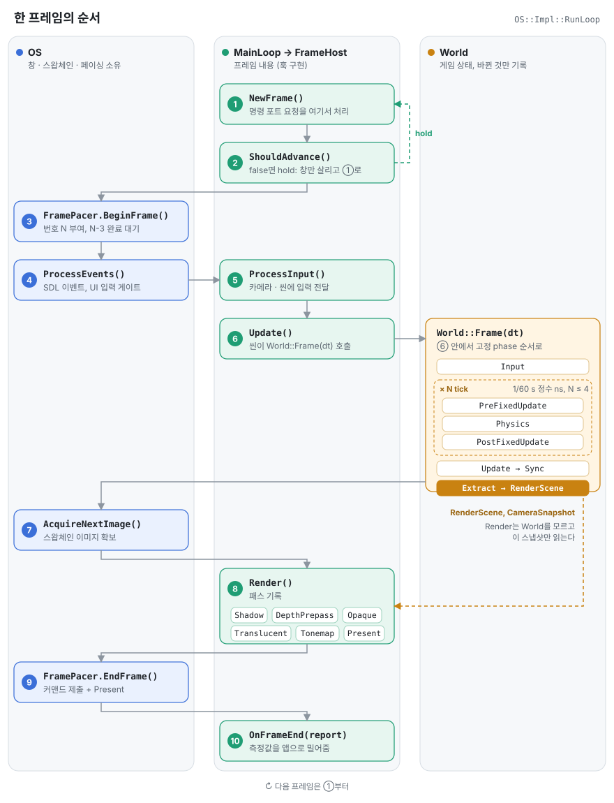

# OS와 MainLoop, 그리고 한 프레임의 순서

## OS와 MainLoop

창과 이벤트를 다루는 쪽(`OS`)과 프레임 내용을 만드는 쪽(`MainLoop`)을 나눴다.

| | 역할 | 파일 |
|---|---|---|
| `OS` | 창, 스왑체인, `FramePacer`, 커맨드 리스트 풀, 입력, 프로파일러를 소유하고 루프를 돌린다 | [OS.hpp](../Engine/Platform/Public/OS.hpp), [OS.cpp](../Engine/Platform/Private/OS.cpp) |
| `MainLoop` | 루프가 부르는 훅만 있는 인터페이스. 창이나 GPU 동기화는 모른다 | [MainLoop.hpp](../Engine/Platform/Public/MainLoop.hpp) |
| `App` | `MainLoop` 구현. 타이머, hold/step, 캡처할 때 쓰는 고정 스텝 | [AppFramework.hpp](../Engine/App/Public/AppFramework.hpp) |
| `RenderApp` → `FrameHost` | 렌더러 샘플용. 훅을 전부 `FrameHost`에 넘기고 `FrameHost`가 프레임의 순서를 소유한다 | [RenderApp.hpp](../Engine/App/Public/RenderApp.hpp), [FrameHost.hpp](../Engine/App/Public/FrameHost.hpp) |

이렇게 나누면 앱은 "이번 프레임에 뭘 할지"만 쓰면 된다.
프레임 번호 매기기, in-flight 대기, 스왑체인 acquire/present, resize 전 GPU idle 대기는 전부 `OS`가 정해진 자리에서 한다.
그리고 그 결과는 `OnFrameBegin(frame)`, `OnFrameEnd(FrameReport)`처럼 앱 쪽으로 밀어준다.
앱이 `OS` 안을 들여다볼 일이 없다.

진입점은 샘플마다 `Main<T>(argc, argv, WindowConfig)` 하나다.
커맨드라인을 `RuntimeConfig`로 파싱하고 디바이스, `OS`, 앱을 순서대로 만든 다음 `os.Run(app, device)`를 부른다.

## 한 프레임의 순서

`OS::Impl::RunLoop`([OS.cpp](../Engine/Platform/Private/OS.cpp))가 아래 순서를 고정한다.
레인이 그 단계를 맡은 쪽이다. MainLoop 레인은 렌더러 샘플에서 `FrameHost`가 하는 일이다.

순서마다 이유가 있다.

- **명령 포트는 `NewFrame`에서만 처리한다.**
  프레임 N-1은 끝났고 N은 아직 시작 안 한 지점이다.
  외부에서 값을 바꿔도 프레임 중간에 끼어들지 않는다.
  `--hold`로 멈춰 있을 때도 이 지점에서 계속 요청을 받는다.
- **in-flight는 3프레임이다**(`FramesInFlight = 3`).
  `BeginFrame`이 N-3의 완료를 기다리니까, 프레임별 버퍼는 3벌이면 안전하게 다시 쓸 수 있다.
- **고정 tick은 정수 나노초로 센다.**
  `FixedTickClock`([FixedTickClock.hpp](../Engine/Core/Public/FixedTickClock.hpp))은 1/60초를 `16'666'667`ns로 한 번만 반올림해 두고 남은 시간은 carry로 넘긴다.
  부동소수점 누적 오차가 없고 한 프레임에 최대 4 tick까지만 따라잡는다.
  디스플레이는 120Hz라 움직임은 시간으로 진행시키고 golden 테스트는 프레임 수로 센다. 그래서 같은 입력이면 같은 그림이 나온다.
- **World는 Render를 모른다.**
  World의 메시, 라이트, 카메라는 Extract 단계에서 `RenderScene`이랑 `CameraSnapshot`으로 옮겨진다(`WorldRender` 모듈).
  Render는 그 결과만 본다.
  World는 바뀐 것만 기록하니까, 아무것도 안 바뀐 프레임은 다시 계산하는 게 없다.
- **resize는 GPU를 비우고 처리한다.**
  `OS`가 `framePacer.WaitForIdle()` 다음에 스왑체인 크기를 바꾸고 `OnResize`를 부른다.
  앱은 그 안에서 타깃을 바로 다시 만들어도 된다.

## 플랫폼 차이

루프 코드는 Windows랑 macOS가 같다.
차이는 스왑체인을 창에 붙이는 부분에만 있다. Win32 HWND인지 `SDL_Metal_CreateView` / `CAMetalLayer`인지.
그리고 D3D12 Agility SDK export처럼 백엔드 쪽 설정도 다르다.
`Tools/`의 스크립트는 전부 `.ps1` / `.sh` 쌍으로 있다.
